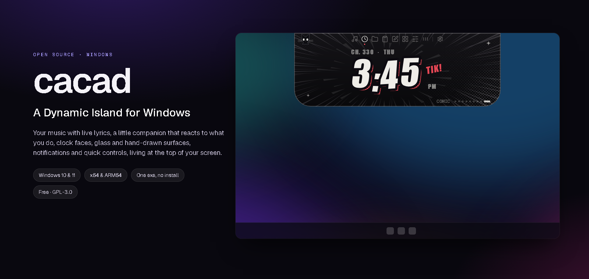
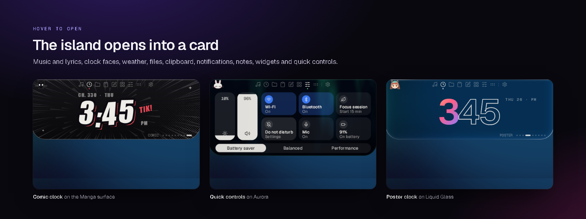
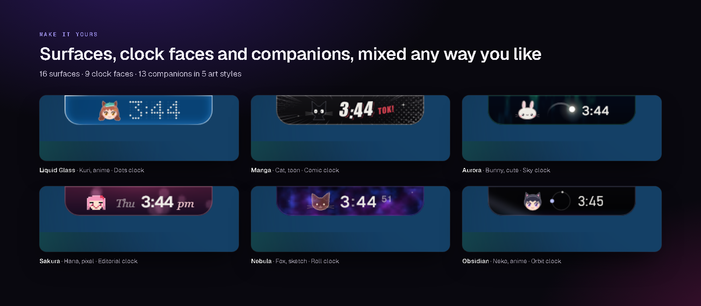
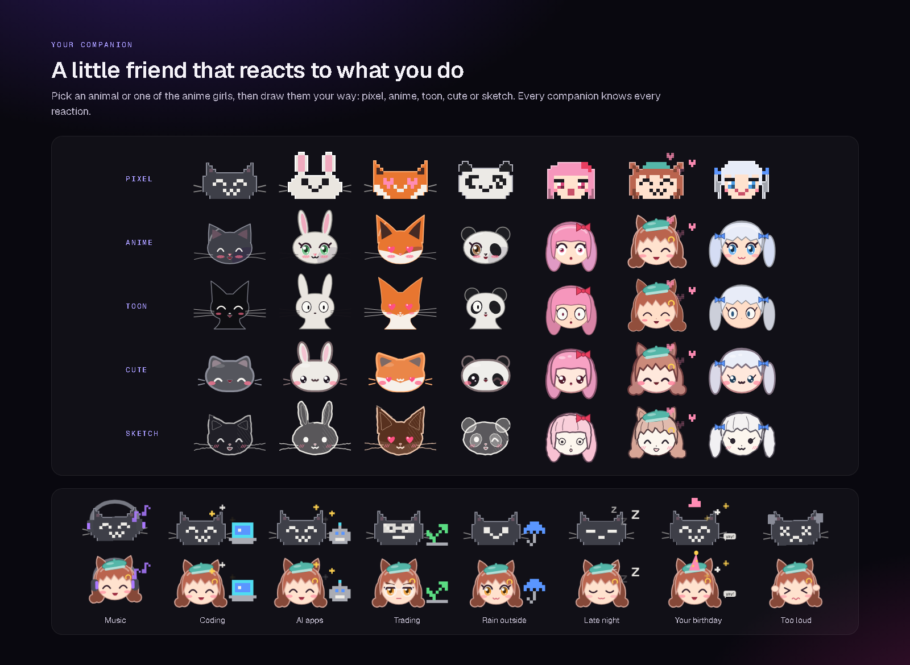
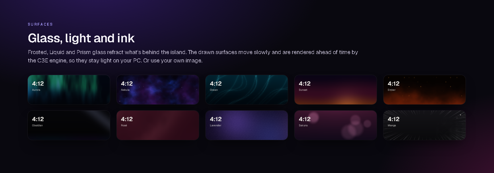
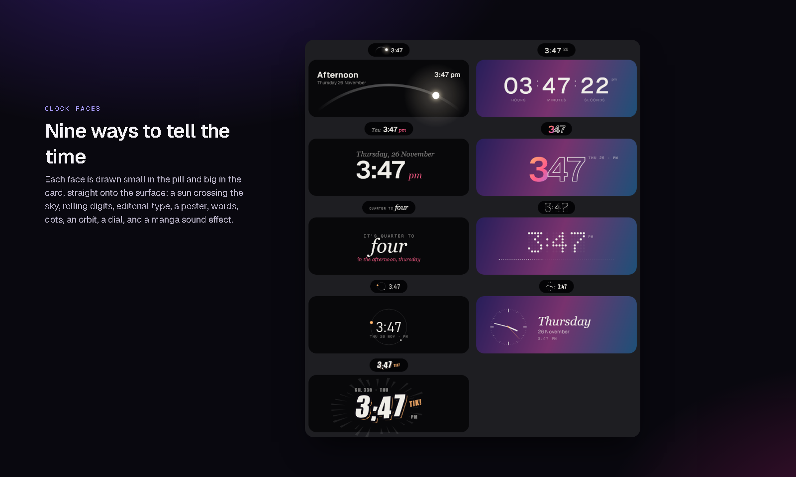

<p align="center">
  
</p>

<h1 align="center">cacad · Windows Notch</h1>

<p align="center">
  A Dynamic Island for Windows: music and live lyrics, a companion that reacts to what you do,<br>
  clock faces, glass and drawn surfaces, notifications and quick controls, at the top of your screen.
</p>

<p align="center">
  <a href="../../releases/latest/download/cacad-x64.exe"><b>Download for Windows (x64)</b></a> ·
  <a href="../../releases/latest/download/cacad-arm64.exe">ARM64</a> ·
  <a href="../../releases/latest">All releases</a>
</p>

<p align="center">
  Windows 10 (2004+) and 11 · one exe, nothing to install · updates itself · free and open source (GPL-3.0)
</p>

---

## Getting started

1. Download **`cacad-x64.exe`** (or `cacad-arm64.exe` for Snapdragon / ARM PCs) from the [latest release](../../releases/latest).
2. Put it somewhere it can stay, like a `cacad` folder in your Documents, and run it.
3. The island appears at the top of your screen. Hover it to open it. Right-click it (or use the tray icon) for **Settings**.

> **"Windows protected your PC"?** cacad isn't code-signed yet (certificates cost money every year), so SmartScreen
> warns about new downloads. Click **More info → Run anyway**. The whole source is here if you'd like to check it or
> build it yourself.

---

## What it does

<p align="center"></p>

- **Music.** Whatever is playing (Spotify, YouTube Music in a browser, Apple Music, any app that shows in Windows' media controls): artwork, controls and a progress bar you can scrub.
- **Live lyrics.** The line being sung shows in the pill, and the Lyrics tab scrolls the whole song the way Apple Music does. Click a line to jump there.
- **A visualizer that follows the music**, listening to what your PC plays.
- **Clock faces**, weather, a file shelf, clipboard history with smart actions (codes, colours, emails, addresses), notes and to-dos, widgets and an app launcher.
- **Notifications** from your apps mirrored on the island, with a history tab, per-app mute and a private mode.
- **Quick controls:** brightness, volume, Wi-Fi, Bluetooth, focus sessions, do not disturb, mic and power mode.
- **Peeks** for volume and brightness (replacing the Windows pop-ups), devices connecting, USB drives, screenshots, Caps Lock, lock and network changes, calls and downloads.

<p align="center"></p>

## Your companion

<p align="center"></p>

A little friend lives on the island and reacts to what you're doing: it puts on headphones and sings along to lyrics, opens a laptop when you code, waves at AI apps, watches the charts in trading apps, holds an umbrella when it's raining outside, yawns late at night and covers its ears when music is too loud.

- **13 companions:** seven animals and six anime girls, all original designs.
- **5 art styles:** pixel, anime, toon, cute and sketch. Every companion has every style, and every reaction.
- **10 coats**, and **hats** that unlock as it levels up. Feed it by finishing focus sessions, timers and to-dos.

## Surfaces and clock faces

<p align="center"></p>

Black, Graphite, three kinds of glass (Frosted, Liquid and Prism) that refract what's behind the island, a Custom surface from your own image or colours, and drawn surfaces: Aurora, Nebula, Ocean, Sunset, Ember, Obsidian, Rosé, Lavender, Sakura and Manga.

<p align="center"></p>

## Light on your PC

Two engines keep cacad cheap to run, and both can be switched off in Settings → Performance:

- **C3E (surfaces)** renders the animated surfaces' next frames ahead of time on a background thread, and has the glass look at the screen behind it only when something changed.
- **Z3R (the whole app)** redraws just the companion when only it moves, and after 20 seconds of nothing happening rests in Windows' efficiency mode and gives memory back. It wakes the moment you hover, a song plays or anything shows.

At rest cacad typically uses around 1% CPU and 25–35 MB of memory.

## Updates

cacad checks this repository's [releases](../../releases) every few hours. When there's a new version it downloads the exe for your PC, checks it against the release's `SHA256SUMS.txt`, and installs it the next time your PC is idle: a quick restart, and your settings stay. In **Settings → Updates** you can choose *Automatic*, *Just tell me* or *Off*, and check right away.

Installing replaces the exe where it is, so keep cacad in a folder you can write to (not `Program Files`).

## Privacy

Your settings, clipboard history, notes and shelf stay on your PC (`%AppData%\cacad`). cacad only goes online for:

| Feature | Service | What's sent |
|---|---|---|
| Lyrics | [lrclib.net](https://lrclib.net) | The playing song's title, artist, album and length |
| Weather | [open-meteo.com](https://open-meteo.com) | Your approximate location (Windows location, or the city you type) |
| Updates | [github.com](https://github.com) | A request for the latest release |

Each can be turned off in Settings. Notification mirroring reads your notifications through Windows' notification access, on your PC only; nothing about them leaves it.

---

## Building from source

You need Windows 10 or 11 and the [.NET 8 SDK](https://dotnet.microsoft.com/download/dotnet/8.0).

```powershell
git clone https://github.com/vkr771/cacad-windows.git
cd cacad-windows
dotnet run --project src/Cacad.App
```

To build the release exes (single file, self-contained, x64 and ARM64) with their checksums:

```powershell
.\build-release.ps1 1.3.0
```

They land in `dist\v1.3.0\`. To publish an update, create a GitHub release tagged `v1.3.0` and attach `cacad-x64.exe`, `cacad-arm64.exe` and `SHA256SUMS.txt`. Running copies pick it up on their own.

### Project layout

| Folder | What's in it |
|---|---|
| `src/Cacad.App/Island` | The island window, its panels, clock faces, surfaces, lyrics view, companion art and engines |
| `src/Cacad.App/Services` | Media, audio, lyrics, weather, notifications and the updater |
| `src/Cacad.App/Gfx` | Drawing helpers, fonts, icons, progress bars and visualizers |
| `src/Cacad.App/Ui` | The Settings window |
| `src/Cacad.App/Core` | Settings, themes and Windows interop |

Everything on the island is drawn in code with [SkiaSharp](https://github.com/mono/SkiaSharp): no image assets apart from the fonts.

## Team

- [@vkr771](https://github.com/vkr771)
- [@harshadnaidu221](https://github.com/harshadnaidu221)
- [@tigergamingstuckrd-sudo](https://github.com/tigergamingstuckrd-sudo)

## Contributing

Issues and pull requests are welcome. For a bigger change, open an issue first so we can talk it through. Please keep new artwork original (no characters, logos or art from existing franchises).

## Licence

cacad is free software under the [GNU General Public License v3.0](LICENSE): you can use, study, share and change it, and if you share a changed version, it must stay open source under the same licence. Third-party components and their licences are listed in [THIRD-PARTY-NOTICES.md](THIRD-PARTY-NOTICES.md).
